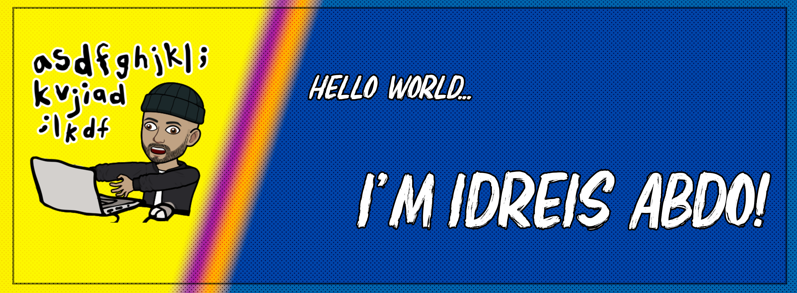

## 
Welcome to my github profile! 🐧

🎓 Graduated in Information Systems & Computer Science at the University of Auckland.  
🐱‍🚀 Always looking to better myself through continuous experimentation and self-reflection!  
🐧💙 Penguins are my favourite animal.

## 
Statistics🔢

  
  

